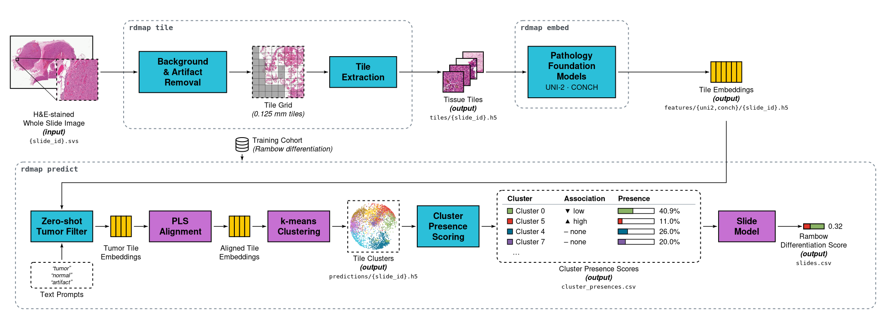
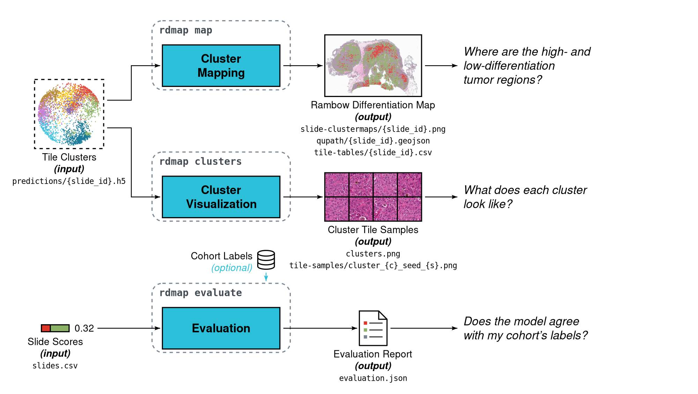

# rdmap — Rambow differentiation maps

`rdmap` finds tumor tile clusters associated with high or low **Rambow differentiation** in H&E
whole-slide images (WSIs) of in-transit melanoma metastases, and maps them back onto the slides.

[](assets/figures/rdmap-1-pipeline.svg)

Each dashed box is one `rdmap` command. Blue boxes are fixed operations; pink boxes are learned from a labelled
training cohort (`rdmap fit` re-learns them); yellow bars are tile embeddings. Every artifact written to disk is
marked *(output)* with its file name. See [Method](#method) for details.

**No data is distributed with this repository.** You bring your own slides and either

- **A.** run our **pretrained model** (`models/uni2-itmm-rambow-differentiation-v1`) on them, or
- **B.** **train your own model** on labelled slides and apply it to other cohorts.

Contents: [Requirements](#requirements) · [Installation](#installation) · [Quickstart](#quickstart-pretrained-model) ·
[Outputs](#outputs) · [QuPath](#viewing-results-in-qupath) · [Labelled cohorts](#evaluating-on-a-labelled-cohort) ·
[Training](#training-your-own-model) · [Metadata CSV](#slide-metadata-csv) · [Configuration](#configuration) ·
[Commands](#command-reference) · [Clusters (SLURM)](#running-on-a-cluster-slurm) · [Method](#method) ·
[Limitations](#interpretation-and-limitations) · [Licence](#licence)

## Requirements

- Linux and Python 3.11+. The released model was built and verified with the exact versions in
  `requirements-locked.txt` (Python 3.13).
- A CUDA GPU for feature extraction. It runs on CPU too, but very slowly.
- Disk space: tiles take about 150 KB per tile (typically 0.5–3 GB per slide); features about 8 KB per tile.
- **Access to the two foundation models**, which are gated on Hugging Face:
  1. Request access to [MahmoodLab/UNI2-h](https://huggingface.co/MahmoodLab/UNI2-h) and
     [MahmoodLab/CONCH](https://huggingface.co/MahmoodLab/CONCH) with your Hugging Face account.
     The models' authors review requests and ask for an institutional email address.
  2. Create a [read token](https://huggingface.co/settings/tokens) and put it in `.env` as `HF_TOKEN=...`.
     Alternatively, log in once with `huggingface-cli login`.

  Both models are released for **non-commercial academic research only** (CC-BY-NC-ND 4.0). Please read
  their terms. The weights are downloaded on first use to `MODELS_DIR` (default `~/.cache/rdmap`), pinned
  to the exact revisions our model was built with.

## Installation

```bash
git clone https://github.com/davidliu-lab/differentiation-map.git && cd differentiation-map
make install          # creates .venv and installs rdmap with compatible (latest) dependency versions
cp .env.example .env  # then edit: HF_TOKEN, and optionally DATA_DIR / OUTPUT_DIR / MODELS_DIR
make shell            # a shell with .venv activated and .env exported
```

`make install-locked` installs the exact verified versions instead. `rdmap` can also be installed into an
existing environment with `pip install -e .`. `make help` lists all Makefile targets. Without `make`, run:

```bash
python3 -m venv .venv && source .venv/bin/activate
pip install -e .     # or: pip install -r requirements-locked.txt -e .  (exact verified versions)
```

and export the variables from `.env` yourself.

## Quickstart (pretrained model)

```bash
rdmap run --wsi-dir /path/to/slides
```

This runs every stage: **tile → embed → predict → map → clusters**. Each finished stage, and each
finished slide within a stage, is skipped when you re-run, so you can interrupt and resume at any time.

The command shows progress bars with time estimates on a terminal, and periodic status lines in logs.
Slides are found by file extension (`.svs .tif .tiff .ndpi .mrxs .scn`; use `--glob "*.svs"` to restrict
this), and each slide's ID is its file name without the extension.

| Location | Content |
|---|---|
| `data/<cohort>/` | tiles and features (reused by later runs) |
| `outputs/uni2-itmm-rambow-differentiation-v1/<cohort>/` | results (see [Outputs](#outputs)) |

`<cohort>` is the folder name of `--wsi-dir`; change it with `--name`. If you have a
[metadata CSV](#slide-metadata-csv) with labels, add `--metadata slides.csv --label-column my_label`.

## Outputs

`rdmap predict` writes the per-tile clusters and per-slide scores. `rdmap map`, `rdmap clusters` and
`rdmap evaluate` turn them into slide maps, cluster figures and an evaluation (which needs labels):

[](assets/figures/rdmap-2-exploring-results.svg)

All results go to `outputs/<model name>/<cohort>/`.

| File | Content |
|---|---|
| `slides.csv` | one row per slide (see below) |
| `tile-tables/{slide_id}.csv` | one row per tissue tile: `x, y, w, h` (tile rectangle in level-0 pixels, origin top-left), `row, col` (grid position), `tumor` (tumor filter result), `cluster`, `rd_association` |
| `qupath/{slide_id}.geojson` | tumor tiles for [QuPath](#viewing-results-in-qupath), coloured by association |
| `cluster_presences.csv` | per slide: fraction of (sampled) tumor tiles in each cluster |
| `clusters.png` | one panel per cluster: statistics and a mosaic of example tiles |
| `tile-samples/cluster_{c}_seed_{s}.png` | 25 example tiles of cluster `c`, closest to the cluster centre first |
| `slide-clustermaps/{slide_id}.png` | slide thumbnail, the high/low-associated clusters overlaid, and the slide's cluster presences |
| `predictions/{slide_id}.h5` | raw per-tile predictions (used by the other commands) |
| `evaluation.json` | only for labelled cohorts, see [below](#evaluating-on-a-labelled-cohort) |

**Cluster association.** During training, each cluster is tested for over-representation in high versus
low Rambow differentiation slides (Mann-Whitney U on per-slide cluster presence, p < 0.05). The result,
`rd_association`, is one of:
- `high`: significantly more frequent in high slides;
- `low`: significantly more frequent in low slides;
- `none`: neither.

Tiles carry their cluster's association. They do not get a per-tile score.

**`slides.csv` columns:**

| Column | Meaning |
|---|---|
| `slide_id`, `mpp` | slide and its resolution (microns per pixel) |
| `n_foreground`, `n_tumor`, `n_sampled_tumor` | tissue tiles, tumor tiles, and tumor tiles in the per-slide sample (up to 1000 tissue tiles) |
| `presence_<k>` | fraction of sampled tumor tiles in cluster `k` |
| `presence_high`, `presence_low` | summed presence of the high- and low-associated clusters |
| `rd_high_proba` | predicted probability of high Rambow differentiation (logistic model on `presence_high` and `presence_low`) |
| `rd_high` | `Yes` if `rd_high_proba >= 0.5` |
| `rambow_differentiation_high` | your label (`Yes`/`No`), if you provided one |

## Viewing results in QuPath

1. Open the slide in [QuPath](https://qupath.github.io/).
2. Drag `qupath/{slide_id}.geojson` onto the viewer, or use *File › Import objects from file*.

Each tumor tile appears as a tile object classified as:
- `RD high` (red);
- `RD low` (green);
- `RD none` (grey).

Each tile's cluster ID is stored as a measurement. To colour tiles by cluster instead, run
`rdmap map … --geojson-class cluster`.

Coordinates are level-0 pixels as read by OpenSlide/tifffile. They have been checked for `.svs` and
OME-TIFF files. Formats whose tissue origin is offset in QuPath (e.g. some `.mrxs`) have not been tested.

## Evaluating on a labelled cohort

With a [metadata CSV](#slide-metadata-csv) and a label column:

```bash
rdmap run      --wsi-dir /path/to/slides --metadata slides.csv --label-column my_label
rdmap evaluate --wsi-dir /path/to/slides --metadata slides.csv --label-column my_label
```

`evaluate` prints and saves (`evaluation.json`):
- the AUC of `rd_high_proba`;
- accuracy, sensitivity, specificity and the confusion matrix at the 0.5 threshold;
- each cluster's p-value and association recomputed on your cohort, next to the values from the model's
  training cohort.

## Training your own model

You need slides with a label: either a continuous Rambow differentiation score (binarised at
`label.cutoff`, default 0.5) or `Yes`/`No`. Describe your cohorts in a config file:

```bash
cp configs/cohorts.example.toml cohorts.toml   # edit paths, metadata CSV and label column
rdmap tile  -c cohorts.toml --cohort my-training
rdmap embed -c cohorts.toml --cohort my-training
rdmap fit   -c cohorts.toml --cohort my-training --out outputs/my-model
```

`fit` writes:
- the model to `outputs/my-model/model/` (`model.json` + `model.npz`);
- private per-slide training statistics to `outputs/my-model/training/`.

It prints each cluster's p-value and association, and checks that the fast numpy inference reproduces
scikit-learn exactly. Apply the model to any cohort with `--model`:

```bash
rdmap run -c cohorts.toml --cohort my-inference --model outputs/my-model/model
rdmap map -c cohorts.toml --cohort my-training --model outputs/my-model/model \
    --training-stats outputs/my-model/training   # adds the training reference boxplots
```

The method parameters (number of PLS components and clusters, seeds, sample size, significance level) are
in `configs/default.toml`. Override them in your own config file rather than editing the defaults.

## Slide metadata CSV

The CSV is optional and can live anywhere, for example next to your slides. It's required only by `fit`
and `evaluate`. There is one row per slide; extra columns are ignored.

| Column | Required | Meaning |
|---|---|---|
| `slide_id` | yes | slide identifier; names the output files (column name configurable with `slide_id_column`) |
| `filename` | no | WSI file name in the slide folder. By default, files are matched by slide ID (file name without extension) |
| *label* | for `fit`/`evaluate` | name given by `label_column`; a continuous score or `Yes`/`No`. Empty means unlabelled |
| `mpp` | no | microns per pixel, if the WSI files lack this metadata |

With a CSV, slides are processed **in CSV order**. Without one, they're processed in sorted ID order.
Training reproducibility depends on this order, because the per-slide tile sample shares one random
generator across slides.

## Configuration

Every command loads `configs/default.toml` first. Files passed with `-c` are merged on top of it, so they
only need the keys they change. Values can reference environment variables as `${VAR}` or
`${VAR:-default}`.

| Section | Contents |
|---|---|
| `[paths]` | `data_dir` (tiles and features), `output_dir`, `models_dir` (backbone weights); defaults come from `DATA_DIR`, `OUTPUT_DIR`, `MODELS_DIR` |
| `[tiling]` | `tile_mm` (physical tile size, 0.125 mm), `output_px` (224), background threshold and HSV background/artifact ranges |
| `[embedding]` | `batch_size` (halved automatically on GPU out-of-memory errors), `device` |
| `[sampling]` | per-slide tile sample: `bagsize` (1000), `seed` |
| `[label]`, `[model]`, `[rd_association]`, `[slide_model]` | training parameters (used by `fit` only) |
| `[figures]` | figure settings and cluster selection rules (`max_p_value`) |
| `[cohorts.<name>]` | `wsi_dir`, `wsi_glob`, `metadata`, `label_column`, `slide_id_column`, `filename_column`, `root`, `mpp`, and a `[cohorts.<name>.tiling]` override table |

When predicting, everything that defines the model (backbones, preprocessing, clusters, label
definition, slide model) comes from the model folder, not from the config. `predict` warns if your tiles
or features don't match the model's input (tile size, backbone revision).

**Check the tiling on your scanner.** Background and artifact detection uses HSV colour thresholds tuned
for our scanners. Look at a few slide cluster maps or QuPath overlays. If tissue is missed, or background
or pen marks are kept, override the `background_*`/`artifact_*` ranges in `[cohorts.<name>.tiling]`.
Then delete that cohort's `tiles/` and `features/` and re-run.

## Command reference

All commands accept a cohort as either `-c FILE --cohort NAME` or
`--wsi-dir DIR [--glob PAT] [--metadata CSV] [--label-column COL] [--mpp MPP] [--name NAME]`, plus
`--progress {auto,bar,log,off}`, `-q` and `--fail-fast`. Run `rdmap <command> --help` for details.

| Command | Purpose |
|---|---|
| `run` | all stages below, in order, skipping finished work |
| `slides` | list the cohort's slide IDs, one per line |
| `tile` | cut slides into tiles and flag background (`--slide-id` for one slide) |
| `embed` | UNI-2 and CONCH features (`--backbone`, `--slide-id`) |
| `fit` | train a model (needs labels) |
| `predict` | per-tile clusters, `slides.csv`, `cluster_presences.csv` |
| `map` | per-tile tables, QuPath GeoJSON and slide cluster maps (`--formats csv,geojson,png`) |
| `clusters` | cluster summary figure and per-cluster tile samples |

`map` and `clusters` select which clusters to draw with `--clusters 0,5` or `--max-p 0.05`; by default they use
the p-value rules in `[figures]`.
| `text-features` | recompute the tumor-filter text features (normally automatic) |
| `evaluate` | metrics on a labelled cohort |
| `release-model` | copy a trained model into `models/` with a generated model card |

Commands that write files print their output location. A slide that fails is reported and skipped,
and the command exits with a non-zero status at the end. `--fail-fast` stops at the first failure instead.

## Running on a cluster (SLURM)

`scripts/slurm/tile.sh` and `scripts/slurm/embed.sh` process one slide per array task:

```bash
mkdir -p logs
N=$(.venv/bin/rdmap slides -q -c cohorts.toml --cohort my-cohort | wc -l)
TILE_JOB=$(sbatch --parsable --array=1-$N scripts/slurm/tile.sh -c cohorts.toml --cohort my-cohort)
sbatch --array=1-$N --dependency=afterok:$TILE_JOB scripts/slurm/embed.sh -c cohorts.toml --cohort my-cohort
rdmap run -c cohorts.toml --cohort my-cohort    # afterwards: predict, map and clusters (minutes)
```

Adjust the `#SBATCH` lines (partition, GPU, memory) to your cluster.

## Method

1. **Tiling.**
   - Slides are cut into a non-overlapping grid of 0.125 mm tiles, resized to 224 px.
   - A tile is flagged as background if more than half of its pixels are background or artifact (pen,
     dark marks), judged by HSV colour ranges with morphological filtering.
2. **Features.**
   - Every tile is embedded with [UNI-2](https://huggingface.co/MahmoodLab/UNI2-h) (1536-d) and
     [CONCH](https://huggingface.co/MahmoodLab/CONCH) (512-d).
3. **Tumor filter.**
   - Each tile is classified zero-shot by comparing its CONCH features with CONCH text embeddings of
     prompts describing tumor, normal tissue and artifacts. Only tumor tiles are used further.
4. **Training** (`fit`).
   - Up to 1000 tissue tiles are sampled per slide.
   - Their UNI-2 features are L2-normalised and projected onto 4 components with partial least squares
     (PLS) against the slide-level Rambow differentiation score, then L2-normalised again.
   - k-means then finds 8 clusters.
   - Each cluster's per-slide presence is compared between high and low slides (Mann-Whitney U) to give
     its association.
   - A small logistic regression on the summed presence of high- and low-associated clusters predicts
     `rd_high_proba`.
5. **Inference** (`predict`).
   - The same steps, with the trained parameters, on every tissue tile.
   - Per-slide presences use the same per-slide sample as training. Cluster maps use all tiles.

## Interpretation and limitations

- **Same inputs as training.** The pretrained model is only meaningful with the same backbones and
  revisions, ~0.125 mm tiles and the same tumor filter. These are all fixed by `rdmap`.
- **Domain shift.** Staining, scanners and tissue handling differ between labs and can shift cluster
  assignments. Check a few cluster maps.
- **Associations come from our cohort.** They were established on our training slides; they are not a
  test on your data. With labels, `evaluate` recomputes them on your cohort.
- **Small training set.** The slide model was trained on 33 slides; see the model card for its validation
  numbers.

## Released model

[`models/uni2-itmm-rambow-differentiation-v1`](models/uni2-itmm-rambow-differentiation-v1) contains only
inference parameters:
- the PLS projection and k-means centroids;
- per-cluster summary statistics;
- the slide-model coefficients.

It contains no slide- or patient-level data. Its
[model card](models/uni2-itmm-rambow-differentiation-v1/MODEL_CARD.md) lists the training cohort summary,
cluster associations and validation results.

## Licence

_TODO_. See [LICENSE](LICENSE). Whatever the licence of the code, the released model is derived from UNI-2
and CONCH outputs and **must not be used commercially**.
